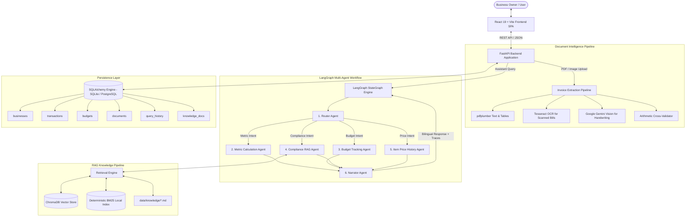

# FinPilot AI – Architecture & System Design

FinPilot AI is a multi-agent financial copilot and decision-support system built for small businesses and retail proprietors. It integrates document intelligence (invoice extraction), multi-agent orchestration (LangGraph), retrieval-augmented generation (RAG for compliance), and an interactive bilingual frontend (React + Vite).

---

## 1. High-Level System Architecture



---

## 2. Core Subsystems

### A. LangGraph Multi-Agent Workflow

The AI Assistant is not a generic chatbot. It is implemented as a deterministic **6-Agent StateGraph** in `backend/app/agents/`:

1. **Router Agent (`router.py`)**:
   - Classifies incoming queries into one of four domain intents: `metric`, `budget`, `compliance`, or `item_price`.
   - Uses an optional OpenAI LLM classification with strict JSON output schema.
   - Includes a deterministic, zero-latency **Hinglish/English keyword router fallback** that works completely offline with zero API keys.

2. **Metric Agent (`tools.py`)**:
   - Queries the SQL database for transactions in the target month (e.g., June, July, or August 2026).
   - Computes exact arithmetic values:
     $$\text{Revenue} = \sum \text{Revenue Txns}$$
     $$\text{Expenses} = \sum \text{Expense Txns}$$
     $$\text{Profit} = \text{Revenue} - \text{Expenses}$$
     $$\text{Margin} = \frac{\text{Profit}}{\text{Revenue}} \times 100\%$$
   - Eliminates LLM calculation hallucination by passing ground-truth numbers into the state.

3. **Budget Agent (`tools.py`)**:
   - Retrieves active spending category limits and sums actual expenditures for the target period.
   - Identifies any categories where $\text{Spent} > \text{Monthly Limit}$, calculating the exact rupee overrun.

4. **Compliance RAG Agent (`tools.py`, `app.rag.retrieve`)**:
   - Executes semantic & keyword retrieval over compliance markdown docs.
   - Evaluates similarity score against threshold ($\ge 0.45$).
   - Attaches formal citations (document title, section, source file).
   - Automatically injects the **Chartered Accountant Review Flag** (`needs_ca_review: true`).

5. **Item Price History Agent (`tools.py`)**:
   - Searches itemized line items from confirmed supplier invoices.
   - Returns the most recent rate, vendor, purchase date, and historical variance.
   - Compares incoming quote/deal to historical baseline without making automated purchasing decisions.

6. **Narrator Agent (`narrator.py`, `hindi.py`)**:
   - Synthesizes findings into natural, professional language.
   - Supports English (`en`) and Hindi (`hi`) with tailored native templates.
   - Appends audit trail and statutory disclaimer.

---

### B. Document & Invoice Intelligence Pipeline

Located in `backend/app/extraction/`:

1. **Layer 1: Digital PDF Parsing (`pdf.py`)**:
   - Uses `pdfplumber` to extract high-fidelity text streams and table grids from native electronic invoices.
2. **Layer 2: Printed OCR (`ocr.py`)**:
   - Uses `pytesseract` and Pillow for scanned PDF pages and JPEG/PNG receipts.
3. **Layer 3: Handwritten Note Recognition (`handwriting.py`)**:
   - Uses Google Gemini Vision (`gemini-flash-latest`) when no printed text is detected.
   - Marks all output as `"Read by AI from handwriting – Verification Required"`.
4. **Deterministic Math Validation (`validator.py`)**:
   - Checks every item line: $\text{Quantity} \times \text{Unit Rate} \approx \text{Amount}$.
   - Cross-checks item sum against invoice subtotal: $\sum \text{Item Amounts} \approx \text{Subtotal}$.
   - Verifies tax calculation: $\text{Subtotal} + \text{Tax Amount} \approx \text{Total Amount}$.
   - Any discrepancy triggers a warning flag in the user review interface.

---

### C. Retrieval-Augmented Generation (RAG) Architecture

Located in `backend/app/rag/`:

- **Document Corpus (`data/knowledge/`)**: 5 markdown documents covering small business GST rules, composition scheme, invoice mandates, TDS on vendor payments, and expense deductibility.
- **Chunking Strategy**: Markdown header-aware chunking (`## ` sections) maintaining semantic coherence and document hierarchy.
- **Dual Vector & Keyword Indexing**:
  - Primary: ChromaDB vector collection `finpilot_compliance` with local persistence.
  - Fallback: Deterministic keyword-density BM25 ranking (`knowledge_index.json`) ensuring 100% offline functionality.
- **Guardrails**: Responses below minimum similarity threshold (0.45) return a safe fallback rather than guessing.

---

### D. Frontend Architecture & Design System

Located in `frontend/src/`:

- **Design System (`index.css`)**: Modern glassmorphic theme using CSS variables (`--bg-primary`, `--accent-primary`, `--card-bg`, etc.).
- **Dynamic Dark / Light Mode**: Real-time theme toggling with smooth color transitions and persistent state.
- **Bilingual i18n (`src/i18n/`)**: Instant toggle between English and Hindi across navigation, metrics, forms, and assistant replies.
- **Interactive Visualizations**: Custom, responsive SVG charts (Monthly trend area charts, category distribution pies, sparklines, and budget progress bars).
- **Agent Trace Inspector**: Live breakdown of the multi-agent execution pipeline showing each active node, latency, and retrieved sources.

---

## 3. Database Schema

Implemented via SQLAlchemy in `backend/app/db/models.py`:

```
+------------------+       +------------------+       +------------------+
|    businesses    |1     *|   transactions   |       |     budgets      |
+------------------+-------+------------------+       +------------------+
| id (PK)          |       | id (PK)          |       | id (PK)          |
| name             |       | business_id (FK) |       | business_id (FK) |
| industry         |       | date             |       | category         |
| language         |       | type (rev/exp)   |       | monthly_limit    |
| created_at       |       | category         |       +------------------+
+------------------+       | amount           |
         |                 | tax_amount       |       +------------------+
         |1                | description      |       |  query_history   |
         |                 | vendor           |       +------------------+
         |*                | source           |       | id (PK)          |
+------------------+       +------------------+       | business_id (FK) |
|    documents     |                                  | question         |
+------------------+                                  | answer           |
| id (PK)          |                                  | agents_used      |
| business_id (FK) |                                  | language         |
| filename         |                                  | created_at       |
| file_path        |                                  +------------------+
| total_amount     |
| status           |
| parsed_data      |
+------------------+
```
